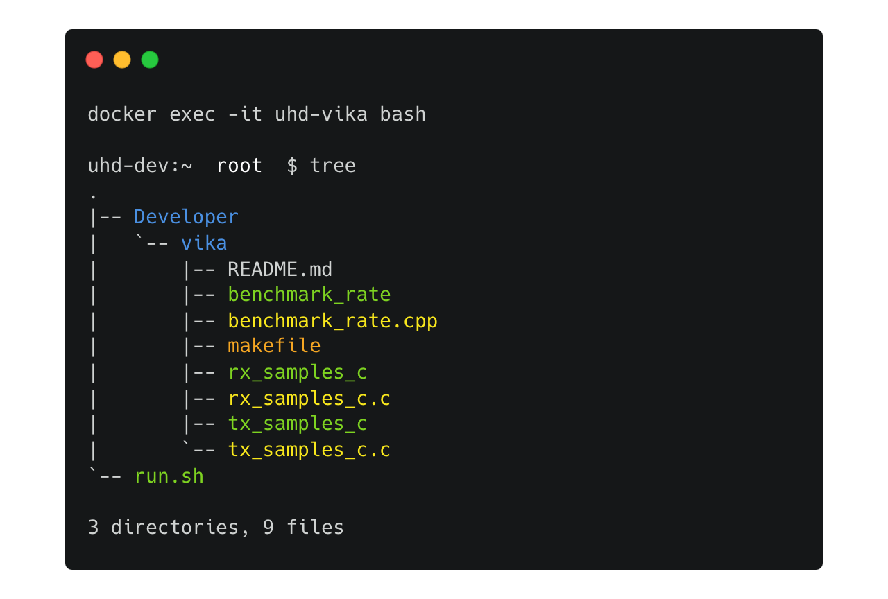

# UHD Docker

Create a developer environment inside a Docker container

To build the base image and launch a container:

```
make
```

To attach to the container:

```
make attach
```

or

```
docker exec -it uhd-vika bash
```

If you try attaching to the container and run the command `tree`, you should get a directory structure like this in the container



Congratulations! You are now ready to develop

## Other Useful Commands

To check if the container exists

```
docker ps
```

Expect to see:
```
CONTAINER ID   IMAGE                    COMMAND          CREATED          STATUS          PORTS     NAMES
8fd2922e03f4   arrc/uhd-docker:latest   "/root/run.sh"   23 minutes ago   Up 22 minutes             uhd-vika
```
